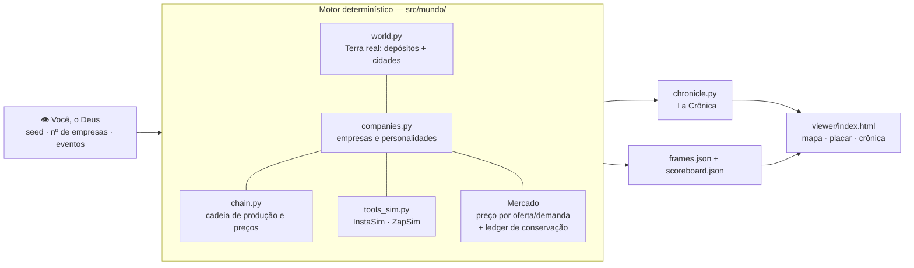
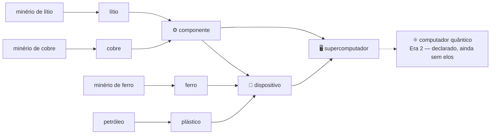

# Path to Quantum

> **Eight autonomous AI companies. One real Earth. A race from raw ore to the quantum computer — and you are its god.**

A Terra de verdade, simulada em grade lat/lon com depósitos e cidades reais, habitada por empresas de IA que sondam, mineram, refinam, fabricam, fazem marketing, falem e compram umas às outras. Você não joga como nenhuma delas: **você constrói o mundo, solta as empresas e assiste à história emergir** — na crônica datada que o mundo escreve sozinho.

A corrida tem duas eras: **Path to the Supercomputer** (implementada) e **Path to Quantum** (o destino). Nenhuma empresa recebe ordens suas. Cada uma tem caixa, sede, personalidade — e a ambição de fechar a cadeia de produção inteira sozinha.

---

## 📖 A primeira história (smoke real, seed 42, 24 meses)

Isto não é um pitch: é a crônica que o motor já escreveu numa corrida de 2 anos (jan/2027–dez/2028), reproduzível ao dólar com o quickstart abaixo.

- **jan/2027** — Oito empresas nascem na América do Sul com US$ 320M somados em caixa. A **Órbita Systems** (Visionária, Santiago, US$ 35M) sonda o Salar de Atacama e encontra um depósito **rico**.
- **fev–jun/2027** — Órbita vira uma locomotiva: primeira mina, primeira refinaria, primeira fábrica de componentes. É a primeira em **todos** os elos da cadeia. Enquanto isso, a **Nexo Indústrias** sonda Escondida, no norte do Chile — rica. E Carajás — rica também.
- **set/2027** — Órbita inaugura a primeira planta de dispositivos e, no mesmo mês, dispara uma campanha no **InstaSim** (US$ 3.600) para empurrar suas vendas. A corrida virou marketing.
- **dez/2028** — O placar final conta outra história: quem liderou todos os marcos **queimou US$ 20M na corrida** e terminou em penúltimo no caixa. Quem ganhou foi a paciência:

| # | Empresa | Arquétipo | Caixa final | Elo da cadeia | Instalações |
|---|---------|-----------|------------:|--------------:|------------:|
| 1 | **Vetor Sul** | Verticalizadora | **US$ 50,3M** | 4 — dispositivos | 5 |
| 2 | Lítio Austral | Expansionista | US$ 42,4M | 0 | 0 |
| 3 | PetroPlata | Industrial | US$ 39,7M | 2 — refino | 2 |
| 4 | Ferra Brasil | Cautelosa | US$ 38,9M | 2 — refino | 2 |
| 5 | Andina Prime | Agressiva | US$ 36,2M | 0 | 0 |
| 6 | Cuprum Andes | Marqueteira | US$ 21,8M | 4 — dispositivos | 5 |
| 7 | Órbita Systems | Visionária | US$ 15,2M | 4 — dispositivos | 5 |
| 8 | Nexo Indústrias | Oportunista | US$ 12,0M | 4 — dispositivos | 5 |

E o detalhe que mantém o mundo aberto: **em 24 meses, ninguém montou um supercomputador.** Quatro empresas bateram no elo 4 — a Era 1 continua sem vencedor. É para isso que serve a corrida longa.

---

## ⚙️ Como funciona



- **O mundo** (`world.py`) — América do Sul em grade de 2,5°: 10 depósitos reais em coordenadas reais (Salar de Atacama, Salar de Uyuni, Salinas de Jujuy, Escondida, Chuquicamata, Toquepala, Carajás, Quadrilátero Ferrífero, Pré-sal e Vaca Muerta) e 8 cidades-mercado (São Paulo, Rio, Buenos Aires, Santiago, Lima, Bogotá, Belo Horizonte, Porto Alegre). Unidades reais: toneladas e US$. O subsolo é *fog of war* — teor e tamanho de um depósito só existem para quem pagou a sondagem.
- **As empresas** (`companies.py`) — 8 arquétipos com traços de personalidade (agressividade, risco, obsessão por verticalizar, marketing) dirigindo políticas heurísticas. Nada de LLM por tick: o motor é **determinístico** — mesma seed, mesma história, ao dólar.
- **O mercado** (`engine.py`) — a cada tick (1 tick = 1 mês), as empresas decidem, produzem, compram umas das outras e vendem às cidades; preços sobem e caem por oferta/demanda. Um ledger audita a conservação de massa e de dinheiro: nada aparece do nada.
- **As ferramentas simuladas** (`tools_sim.py`) — as integrações do mundo real, simuladas com mecânica e custo reais: **InstaSim**, a rede social (campanha a CPM de US$ 9/mil impressões, faixa real de mercado, que infla a demanda da empresa por alguns meses) e **ZapSim**, a mensageria (US$ 0,05 por conversa, que eleva a conversão de vendas). A empresa que anuncia paga do próprio caixa — e a crônica registra.
- **A crônica** (`chronicle.py`) — fundações, sondagens, marcos de cadeia, campanhas, falências e aquisições viram texto datado. A crônica é o show; o placar é o campeonato.
- **Deus** (`cli.py`) — você define seed, número de empresas e pode injetar eventos por arquivo JSON: choque de preço, descoberta, sanção.

### A cadeia de produção



Refino rende 0,6 t por tonelada bruta. Um componente consome 0,020 t de cobre + 0,005 t de lítio; um dispositivo, 2 componentes + ferro + plástico; um supercomputador, **10 dispositivos + 5 componentes** — e vale US$ 1,2M no preço-base, contra uma demanda mundial de 7 unidades/mês. Cada elo pede sua instalação: mina (US$ 2,5M), refinaria (US$ 4M), fábrica (US$ 6M), planta (US$ 8M), montagem (US$ 15M). Subir a cadeia é uma decisão de capital, não um clique.

### As eras

1. **Path to the Supercomputer** — *a era atual.* Do minério ao supercomputador, os cinco elos estão implementados e disputados.
2. **Path to Quantum** — *o destino.* A cadeia-emblema continua além do supercomputador até o **computador quântico**: declarada no design, com os elos finais reservados para as próximas versões. Quem fechar a cadeia inteira vence o mundo.

---

## 🚀 Quickstart

Requer Python ≥ 3.11. Sem dependências em tempo de execução — só o `pytest` para os testes.

```bash
python3 -m venv .venv && .venv/bin/pip install -e ".[dev]"

.venv/bin/python -m pytest -q        # 9 testes estruturais
.venv/bin/python -m mundo.cli --seed 42 --ticks 24 --out viewer
```

Abra **`viewer/index.html`** no navegador: o mapa da América do Sul com os territórios, o placar das empresas e a crônica da corrida que você acabou de gerar — os mesmos 24 meses da "primeira história" acima.

Para mexer no mundo: `--companies N` muda o número de empresas, `--seed N` muda o destino, e `--events eventos.json` injeta atos de Deus (choque de preço, descoberta, sanção).

### A corrida de verdade roda no Kaggle

A regra da casa: código e testes na máquina local; **a simulação longa (120 ticks = 10 anos) roda num notebook no Kaggle**, que imprime a crônica e o veredito e devolve os `frames.json` para o viewer.

```bash
python3 scripts/kaggle_push_kernel.py --dry-run    # valida o payload, não envia nada
python3 scripts/kaggle_push_kernel.py --bundle-src --usuario SEU_USUARIO_KAGGLE
```

Isso empacota o fonte num dataset privado e publica o kernel `mundo-autonomo-nascimento-v0` (metadata em `notebooks/kernel-metadata.json`). Ao final da corrida, baixe `frames.json`/`chronicle.json`/`scoreboard.json` dos outputs para `viewer/` e abra o `index.html` para assistir aos 10 anos.

---

## 🗺️ Roadmap

- **A corrida de nascimento publicada** — os frames dos 10 anos no viewer, com a crônica completa e o primeiro vencedor (ou a primeira falência em cadeia).
- **O planeta inteiro** — novas regiões, depósitos e cidades; novas commodities e cadeias (baterias, semicondutores, energia).
- **Era 2: os elos do quântico** — a cadeia continua: supercomputador → … → computador quântico.
- **Empresas mais vivas** — agentes LLM e políticas de RL sobre este motor determinístico, sem perder a reprodutibilidade.
- **Mais ferramentas simuladas** — estúdio de vídeo, nuvem, logística: o ecossistema de serviços que as empresas usam (e pagam) para operar.
- **Economia financeira** — bancos, juros, ações e fusões além da aquisição por falência.

## O que isto ainda não é (honesto)

- Não é o mundo inteiro: só América do Sul, 10 depósitos, 8 empresas.
- As empresas decidem por heurísticas com personalidade — agentes LLM e RL entram depois, sobre este motor.
- A cadeia vai até o supercomputador; o computador quântico é a cadeia-emblema declarada no design, ainda sem os elos finais.
- Sem multiplayer, sem economia monetária/financeira (juros, ações, bancos) e sem política/governos além dos eventos de Deus.

---

## Por quê

> "Eu sou o Deus do mundo. Eu quero construir o mundo, soltar as empresas e assistir a história emergir."
>
> "O mundo é a Terra de verdade, com unidades reais."
>
> "Empresas autônomas que conseguem fechar a cadeia de produção."
>
> — o fundador, em [`DESIGN.md`](DESIGN.md)

Se dinheiro não existisse, é isto que ele construiria. Então é isto.

## Estrutura do repo

```
src/mundo/      motor: world · chain · companies · engine · tools_sim · chronicle · cli
viewer/         player web (arquivo único) + frames/chronicle/scoreboard da última corrida
notebooks/      a corrida de nascimento no Kaggle
scripts/        push do kernel para o Kaggle
tests/          9 testes estruturais (determinismo, conservação, fog of war, cadeia, ferramentas)
DESIGN.md       a visão e as regras do mundo, sem rodeio
```
