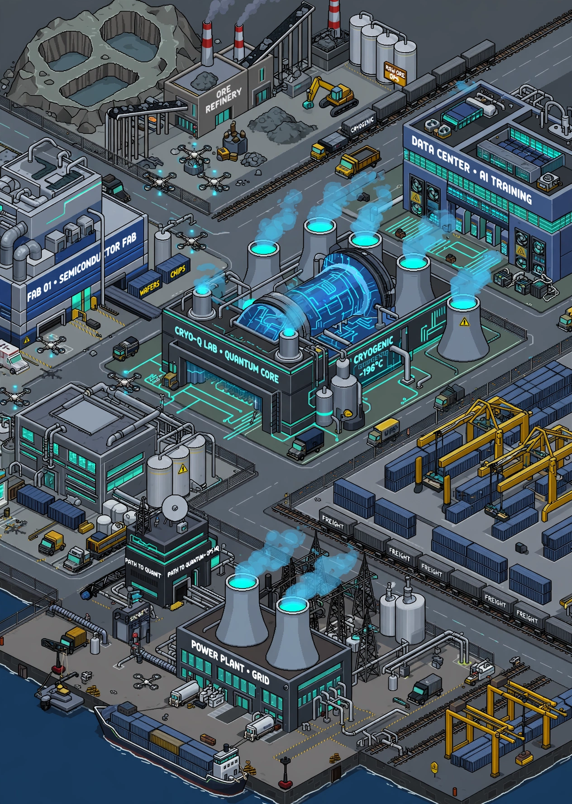
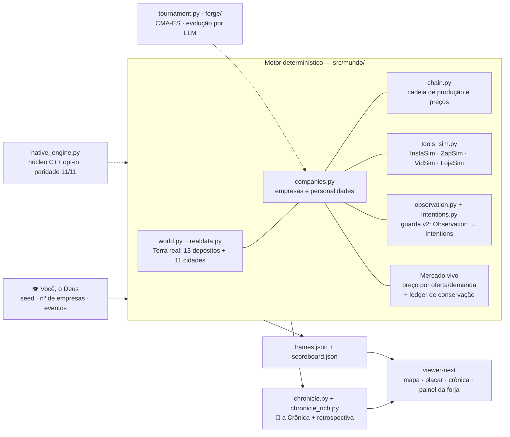
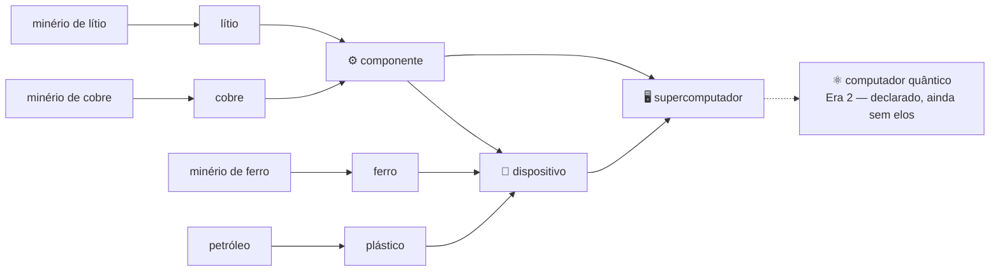

# Path to Quantum

> **Eight autonomous AI companies. One real Earth. A race from raw ore to the quantum computer — and you are its god.**

 -brightgreen)   

A Terra de verdade, simulada em grade lat/lon com depósitos e cidades reais, habitada por empresas de IA que sondam, mineram, refinam, fabricam, fazem marketing, falem e compram umas às outras. Você não joga como nenhuma delas: **você constrói o mundo, solta as empresas e assiste à história emergir** — na crônica datada que o mundo escreve sozinho.

A corrida tem duas eras: **Path to the Supercomputer** (implementada) e **Path to Quantum** (o destino). Nenhuma empresa recebe ordens suas. Cada uma tem caixa, sede, personalidade — e a ambição de fechar a cadeia de produção inteira sozinha. Por baixo, um motor **determinístico** com goldens bit-idênticos, um **núcleo nativo C++** com paridade provada, uma **guarda de informação** que torna o fog-of-war impossível de furar por tipo — e uma **forja** onde LLMs evoluem políticas-código contra esse mundo. Este README é a vitrine; a arquitetura vigente, sem rodeio, é [`docs/ARQUITETURA.md`](docs/ARQUITETURA.md).

---

## 👀 Assista

Rode o quickstart abaixo e abra o **viewer-next** (`cd viewer-next && npm run dev`): mapa da América do Sul com contorno real da Terra, territórios, placar e a crônica da corrida gerada. O viewer aceita qualquer corrida, sobre **os mesmos JSONs** de sempre — o motor não muda:

- `?run=results/<corrida>` — carrega os `frames/chronicle/scoreboard.json` daquela corrida; clicar num marco da crônica salta o replay àquele momento.
- `?forge=results/forge-v1` — o painel da forja: veredito da corrida evolutiva, campeão, avaliação cega e estatísticas do mutador.
- `?compare=results/<outra>` — comparador de corridas por frame final.

> O sistema visual — mapa com contorno real, lentes (Recursos · Produção · Comércio · Empresas · Crônica), fluxo desenhado e crônica tipografada — é o viewer-next, regido pelo ADR-001 e pela SPEC-VISUAL-WOW (fechada). O player original de arquivo único (`viewer/index.html`) foi aposentado: tudo que ele fazia vive no viewer-next (paridade provada no VIS-07).

## 📖 A primeira história (smoke real, seed 42, 24 meses)

Isto não é um pitch: é a crônica que o motor escreveu no smoke que batizou o projeto (mundo v0, seed 42, 2 anos: jan/2027–dez/2028). O mundo cresceu desde então — o quickstart abaixo roda o mundo **atual** (v1, com mercado vivo e as 4 ferramentas) e escreve uma história nova, mais rica; esta fica como o registro histórico da primeira.

- **jan/2027** — Oito empresas nascem na América do Sul com US$ 320M somados em caixa. A **Órbita Systems** (Visionária, Santiago, US$ 35M) sonda o Salar de Atacama e encontra um depósito **rico**.
- **fev–jun/2027** — Órbita vira uma locomotiva: primeira mina, primeira refinaria, primeira fábrica de componentes. É a primeira em **todos** os elos da cadeia. Enquanto isso, a **Nexo Indústrias** sonda Escondida, no norte do Chile — rica. E Carajás — rica também.
- **set/2027** — Órbita inaugura a primeira planta de dispositivos e, no mesmo mês, dispara uma campanha no **InstaSim** (US$ 3.600) para empurrar suas vendas. A corrida virou marketing.
- **dez/2028** — O placar final conta outra história: quem liderou todos os marcos **queimou US$ 20M na corrida** e terminou em penúltimo no caixa. Quem ganhou foi a paciência:

| # | Empresa | Arquétipo | Caixa final | Elo da cadeia | Instalações |
|---|---------|-----------|------------:|--------------:|------------:|
| 1 | **Vetor Sul** | Verticalizadora | **US$ 50,3M** | 4 — dispositivos | 5 |
| 2 | Lítio Austral | Expansionista | US$ 42,4M | 0 | 0 |
| 3 | PetroPlata | Industrial | US$ 39,7M | 2 — refino | 2 |
| 4 | Ferra Brasil | Cautelosa | US$ 38,9M | 2 — refino | 2 |
| 5 | Andina Prime | Agressiva | US$ 36,2M | 0 | 0 |
| 6 | Cuprum Andes | Marqueteira | US$ 21,8M | 4 — dispositivos | 5 |
| 7 | Órbita Systems | Visionária | US$ 15,2M | 4 — dispositivos | 5 |
| 8 | Nexo Indústrias | Oportunista | US$ 12,0M | 4 — dispositivos | 5 |

E o detalhe que mantém o mundo aberto: **em 24 meses, ninguém montou um supercomputador.** Quatro empresas bateram no elo 4 — a Era 1 continua sem vencedor. É para isso que serve a corrida longa. E hoje o mundo já escreve mais do que nesta primeira história: a **crônica rica** detecta rivalidades (disputas por depósito, guerras de preço) e fecha cada era com uma retrospectiva narrada.

---

## ⚙️ Como funciona



- **O mundo** (`world.py` + `realdata.py`) — América do Sul em grade de 2,5° (30×22): **13 depósitos reais** em coordenadas reais (Salar de Atacama, Uyuni, Salinas de Jujuy, Escondida, Chuquicamata, Toquepala, Carajás, Quadrilátero Ferrífero, Pré-sal, Vaca Muerta, Salar del Hombre Muerto, Cerro Verde e El Mutún) e **11 cidades-mercado** (as 8 originais + Montevidéu, Assunção e Medellín), vindos de `data/world_data.json` com **fonte citada por item** (USGS e fontes públicas). O mundo embutido de 10 depósitos/8 cidades é o *fallback* v0, preservado bit-idêntico. Unidades reais: toneladas e US$. O subsolo é *fog of war* — teor e tamanho só existem para quem pagou a sondagem.
- **As empresas** (`companies.py`) — 8 arquétipos com traços de personalidade (agressividade, risco, obsessão por verticalizar, marketing) dirigindo políticas plugáveis. Nada de LLM por tick: o motor é **determinístico** — mesma seed, mesma história, ao dólar.
- **A guarda** (`observation.py` + `intentions.py`) — a política não recebe o motor: recebe uma **Observation** tipada e congelada (só o público + ela mesma) e devolve **Intentions** declarativas, validadas por inteiro antes de executar. Vazamento de informação virou impossibilidade de tipo, não questão de disciplina.
- **O mercado** (`engine.py`) — a cada tick (1 tick = 1 mês), as empresas decidem, produzem, compram umas das outras e vendem às cidades; preços sobem e caem por oferta/demanda num mercado vivo parametrizado por dados reais. Um ledger audita a conservação de massa e de dinheiro: nada aparece do nada. Equipamentos desgastam e quebram; países têm política e comércio externo — tudo dado com fonte, em `data/`.
- **As ferramentas simuladas** (`tools_sim.py`) — as integrações do mundo real, simuladas com mecânica e custo reais: **InstaSim** (rede social, CPM), **ZapSim** (mensageria, custo por conversa), **VidSim** (estúdio de vídeo: campanha que multiplica a demanda de dispositivos e supercomputadores) e **LojaSim** (marketplace: loja + comissão de 13%, como os reais). A empresa que anuncia paga do próprio caixa — e a crônica registra.
- **A crônica** (`chronicle.py` + `chronicle_rich.py`) — fundações, sondagens, marcos de cadeia, campanhas, falências e aquisições viram texto datado; a camada rica deriva rivalidades e a retrospectiva de cada era. A crônica é o show; o placar é o campeonato.
- **Deus** (`cli.py`) — você define seed, número de empresas e pode injetar eventos por arquivo JSON: choque de preço, descoberta, sanção.

### A cadeia de produção



Refino rende 0,6 t por tonelada bruta. Um componente consome 0,020 t de cobre + 0,005 t de lítio; um dispositivo, 2 componentes + ferro + plástico; um supercomputador, **10 dispositivos + 5 componentes** — e vale US$ 1,2M no preço-base, contra uma demanda mundial de 7 unidades/mês. Cada elo pede sua instalação: mina (US$ 2,5M), refinaria (US$ 4M), fábrica (US$ 6M), planta (US$ 8M), montagem (US$ 15M). Subir a cadeia é uma decisão de capital, não um clique.

### As eras

1. **Path to the Supercomputer** — *a era atual.* Do minério ao supercomputador, os cinco elos estão implementados e disputados.
2. **Path to Quantum** — *o destino.* A cadeia-emblema continua além do supercomputador até o **computador quântico**: declarada no design, com os elos finais reservados para as próximas versões. Quem fechar a cadeia inteira vence o mundo.

---

## 📍 Estado real do projeto

Nada aqui é promessa: cada linha diz o status **e onde o item vive** (medido nesta base em 27/10/2026).

| Frente | Status | Onde vive |
|---|---|---|
| Motor determinístico + goldens bit-idênticos | ✅ Entregue | `src/mundo/engine.py` · suíte |
| Mundo v1 — 13 depósitos / 11 cidades com dados reais | ✅ Entregue | `data/world_data.json` · `realdata.py` |
| Ferramentas simuladas (InstaSim, ZapSim, VidSim, LojaSim) | ✅ Entregue | `tools_sim.py` |
| Mundo vivo (mercado, equipamentos, países) | ✅ Entregue | `marketdata/equipdata/countrydata.py` · vereditos B1–B3 nos notebooks |
| Núcleo nativo C++/nanobind | ✅ Paridade **11/11 bit-idêntica** aprovada (Fase 5) | `native_engine.py` + `src/mundo/native/` · `docs/DEGRAU1-LOG.md` |
| Guarda v2 — Observation tipada + Intentions | ✅ Migração fechada | `observation.py` · `intentions.py` · `docs/OBSERVATION-SPEC.md` |
| Torneio de políticas (genoma de 20 genes, CMA-ES em liga) | ✅ Construído e lançado no Kaggle | `genome.py` · `tournament.py` · `notebooks/torneio-v1.ipynb` |
| Crônica rica (rivalidades + retrospectiva por era) | ✅ Entregue (#13) | `chronicle_rich.py` · testes |
| Viewer (replay, `?run=`, comparador, painel da forja) | ✅ Nesta base | `viewer-next/` |
| Forja evolutiva — políticas-código por LLM (#6) | 🚧 Corrida v1 preparada; corridas V6–V8 na linha Kaggle | `forge/` · `program.py` · `docs/FORGE-LOG.md` · branches irmãs da forja |
| Exportador Rerun de corridas (#20) | 🚧 Em branch própria | branch `frente/rerun-exporter` (não está nesta base) |
| Viewer-next — sistema visual por lentes | ✅ Spec VISUAL-WOW fechada | `viewer-next/` — o viewer do projeto; o legado `viewer/` foi aposentado |
| Era 2 — elos até o computador quântico | 📐 Declarada | `DESIGN.md` · issue #17 (épica v3) |
| Licença do projeto | ⚠️ **Em aberto** — não há `LICENSE` neste repo | decisão pendente do fundador; nenhum badge de licença é exibido até existir |

**Suíte nesta base:** `259 passed, 18 skipped` — os 18 skips são os testes de paridade sem o núcleo nativo compilado. Reproduzir (não confie no número, rode): `.venv/bin/python -m pytest -q`.

---

## 🚀 Quickstart

Requer Python ≥ 3.11. O motor não tem dependências de runtime; os testes usam `pytest` e `numpy` (ambos no extra `dev`).

```bash
python3 -m venv .venv && .venv/bin/pip install -e ".[dev]"

.venv/bin/python -m pytest -q        # a suíte estrutural (determinismo, conservação, fog, cadeia, guarda, torneio, forja)
.venv/bin/python -m mundo.cli --seed 42 --ticks 24 --out data/served
```

Abra o **viewer-next** (`cd viewer-next && npm install && npm run dev`): o mapa da América do Sul com os territórios, o placar das empresas e a crônica da corrida de 24 meses que você acabou de gerar no mundo atual. (`data/served/` é a corrida que o viewer abre sem parâmetros; gerar nela substitui a exibida.)

Para mexer no mundo: `--companies N` muda o número de empresas, `--seed N` muda o destino, e `--events eventos.json` injeta atos de Deus (choque de preço, descoberta, sanção).

### A corrida de verdade roda no Kaggle

A regra da casa (ADR-006): código e testes na máquina local; **a simulação longa (120 ticks = 10 anos), o torneio completo e as corridas da forja rodam em notebooks no Kaggle**, que imprimem a crônica e o veredito no protocolo pré-registrado e devolvem os JSONs para o viewer. Os notebooks estão classificados em [`notebooks/README.md`](notebooks/README.md) — do nascimento (`kaggle_mundo_v0.ipynb`) aos vereditos do Degrau 1, ao torneio e à forja.

Para empacotar e publicar um kernel:

```bash
python3 scripts/kaggle_push_kernel.py --dry-run    # valida o payload, não envia nada
python3 scripts/kaggle_push_kernel.py --bundle-src --usuario SEU_USUARIO_KAGGLE
```

Ao final da corrida, baixe `frames.json`/`chronicle.json`/`scoreboard.json` dos outputs para `results/<corrida>/` e abra o viewer com `?run=results/<corrida>` para assistir.

---

## 🏛️ Arquitetura em 1 tela

Cinco invariantes seguram o sistema inteiro (detalhe em [`docs/ARQUITETURA.md`](docs/ARQUITETURA.md)):

1. **Determinismo** — mesma seed, mesma história, ao dólar; goldens bit-idênticos na suíte.
2. **Fog-of-war por tipo** — a política só enxerga a `Observation`; o resto é inacessível por construção.
3. **Conservação auditável** — ledger de massa e dinheiro em todo tick.
4. **Nenhum LLM no tick** — LLMs evoluem políticas *offline*, na forja; a corrida é código determinístico.
5. **Viewer burro** — o viewer só lê 3 JSONs; trocar a interface nunca toca o motor.

## 🗺️ Roadmap

Do plano de versões do PRD (§10), com o já-entregue marcado — não prometido de novo:

- ✅ **v0 Nascimento** — motor, mundo embutido, crônica, viewer, primeira história.
- 🚧 **v1 Mundo maior e vivo — parcial (núcleo entregue)** — recorte América do Sul com mundo real 13/11 e mundo vivo (mercado, equipamentos, países), VidSim/LojaSim, crônica rica e replay no viewer (scrub, `?run=`, comparador) entregues. Continua aberto do v1 do PRD (§10): novos recortes (América do Norte — #11, África, Ásia) e a câmera nos marcos da crônica, que ainda não existe.
- 🚧 **v2 Temporadas de políticas** — torneio CMA-ES lançado; forja evolutiva em corrida (#6); políticas aprendidas disputando temporadas.
- 📐 **v3 Outros deuses e Era 2** — editor de mundos, ligas entre mundos e os elos finais até o computador quântico (épica #17).

## O que isto ainda não é (honesto)

- Não é o mundo inteiro: só América do Sul (13 depósitos, 11 cidades, 8 empresas por corrida).
- A cadeia vai até o supercomputador; o computador quântico é a cadeia-emblema declarada, ainda sem os elos finais.
- As empresas decidem por heurísticas, genomas evoluídos e programas da forja — RL/MARL está desenhado e fora da fila, não implementado.
- Sem multiplayer, sem economia financeira (juros, ações, bancos) e sem política/governos além dos eventos de Deus e dos parâmetros de país.

---

## 📚 Documentação

| Doc | O que é |
|---|---|
| [`docs/ARQUITETURA.md`](docs/ARQUITETURA.md) | **A arquitetura vigente** — componentes, invariantes e todos os módulos. |
| [`DESIGN.md`](DESIGN.md) | A visão e as regras do mundo, na voz do fundador. |
| [`docs/README.md`](docs/README.md) | Índice de todos os documentos, com tipo e status (vigente/histórico/log/estudo). |
| [`docs/adr/`](docs/adr/README.md) | As decisões que ainda mandam, em ADRs curtos. |
| [`docs/PRD.md`](docs/PRD.md) · [`docs/SDD.md`](docs/SDD.md) | Produto e desenho originais (v1.0/v0, históricos com adendo). |
| [`notebooks/README.md`](notebooks/README.md) | Os notebooks Kaggle, classificados (canônico/veredito/diagnóstico). |

## Por quê

> "Eu sou o Deus do mundo. Eu quero construir o mundo, soltar as empresas e assistir a história emergir."
>
> "O mundo é a Terra de verdade, com unidades reais."
>
> "Empresas autônomas que conseguem fechar a cadeia de produção."
>
> — o fundador, em [`DESIGN.md`](DESIGN.md)

Se dinheiro não existisse, é isto que ele construiria. Então é isto.

## Estrutura do repo

```
src/mundo/      motor (23 módulos): engine · native_engine+native/ · world/realdata ·
                chain · companies · policies/genome/program · observation/intentions ·
                tournament/driver · tools_sim · chronicle/chronicle_rich · cli
forge/          a forja evolutiva: mutador LLM · avaliador em cascata · avaliação cega · veredito
viewer-next/    o viewer (Vite + TypeScript): replay · lentes · comparador · painel da forja
data/           mundo real e parâmetros vivos — dado com fonte citada por item · served/ = a corrida exibida pelo viewer
docs/           ARQUITETURA (vigente) · índice · ADRs · PRD/SDD (históricos) · estudos e logs
notebooks/      os experimentos Kaggle, classificados em notebooks/README.md
experiments/    degrau1: artefatos e README do núcleo nativo
scripts/        push de kernels/datasets para o Kaggle
tests/          a suíte estrutural (19 arquivos)
assets/         artes finais do projeto (cover.webp)
DESIGN.md       a visão e as regras do mundo, sem rodeio
```

## Licença

⚠️ **Ainda não definida.** Este repositório não contém um arquivo `LICENSE` — a escolha da licença é uma decisão pendente do fundador e está registrada como item em aberto na tabela de estado. Até lá, nenhum badge ou afirmação de licença se aplica.
