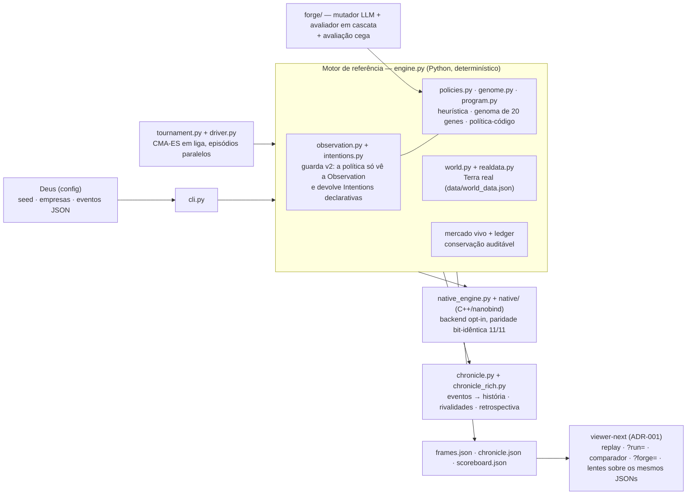

# ARQUITETURA — Path to Quantum (documento vigente)

**Status:** canônico e vigente · **Data:** 27/10/2026 · **Base de código descrita:** branch `vitrine/readme-arquitetura` (viewer/painel-forja + crônica rica #13).

> Este é **o** documento de arquitetura atual do projeto. O [`SDD.md`](SDD.md)
> é o desenho original (v0, 26/10/2026) e o [`PRD.md`](PRD.md) é o documento
> de produto v1.0 — ambos históricos, referenciados daqui, não reescritos.
> Decisões que ainda mandam estão em [`adr/`](adr/README.md). O índice de
> todos os documentos está em [`docs/README.md`](README.md).

---

## 1. O sistema em uma tela

**Os 5 invariantes** (herdados do SDD §2, todos vigentes e testados):

1. **Determinismo** — mesma seed + mesma configuração = mesma história, ao dólar. Um único `random.Random` por mundo; goldens bit-idênticos na suíte.
2. **Fog-of-war por tipo, não por disciplina** — a política recebe uma `Observation` tipada e congelada (guarda v2); o subsolo e o futuro do motor são *inacessíveis por construção*, não por convenção.
3. **Conservação auditável** — ledger de massa e dinheiro: nada aparece do nada; toda corrida pode ser auditada.
4. **Nenhum LLM no tick** — decisão por política (heurística, genoma ou programa evoluído *offline*); LLMs só entram na forja, fora da corrida.
5. **Viewer burro** — o viewer só lê os três JSONs de saída; nenhuma lógica de mundo vive nele. É esse contrato que permite trocar o viewer (viewer-next) sem tocar no motor.

**Regra de computação:** na máquina de desenvolvimento, só código e testes estruturais. **Toda corrida longa, torneio completo e treino roda no Kaggle** (notebooks em `notebooks/`, ver `notebooks/README.md`), que imprime o veredito no protocolo pré-registrado de cada experimento.

## 2. Componentes

### 2.1 Motor de referência (`engine.py`)
Ticks mensais: decisão → produção → mercado → crônica. Preços por oferta/demanda com mercado vivo parametrizado por `marketdata.py`; equipamentos com desgaste/hazard por `equipdata.py`; política externa (países) por `countrydata.py`. Snapshot serializável com replay bit-idêntico (prova da guarda v2, fatia 2).

### 2.2 Núcleo nativo (`native_engine.py` + `src/mundo/native/`)
Backend **opt-in** com a mesma superfície do `Engine` (Fase 5 / Degrau 1): núcleo C++ (`core.cpp`, RNG MT19937 próprio) ligado via nanobind, com paridade **11/11 bit-idêntica** ao motor Python — clássico e mundo vivo, até n=1.000 — e speedup medido no Kaggle de 13,3× (n=100) a 8,6× (n=1.000). A divergência que reprovou a v2 era só de *tipo* (`remaining` nasce `int` no Python); a correção vive em `_restore_int_types` com testes de regressão. Sem o núcleo compilado, os testes de paridade *pulam* (18 skips na suíte) e o motor Python é a referência — nunca um substituto silencioso.

### 2.3 Guarda v2 — Observation e Intentions (`observation.py`, `intentions.py`)
Migração **fechada** (4 fatias, suíte 240/240 à época): a política recebe views congeladas só com o público; `probe` é a única revelação do subsolo; RNG é forward-only. Decisões são **Intentions declarativas** — vocabulário 1:1 dos verbos do mundo; o executor valida a lista inteira antes de executar qualquer item. As fachadas legadas do Engine foram removidas; chamadas v1 viram rejeição nomeada. Spec e log: `OBSERVATION-SPEC.md` / `OBSERVATION-LOG.md`. Decisão: [ADR-004](adr/ADR-004-observation-tipado.md).

### 2.4 Políticas (`policies.py`, `genome.py`, `program.py`)
Três formas, um contrato (`decide(self, obs) -> Intentions`):
- **HeuristicPolicy** — a oficial, parametrizada pela personalidade da empresa (`companies.py`: 8 arquétipos).
- **Genoma** — as ~20 constantes da heurística como vetor contínuo; o **genoma 0 reproduz a política atual bit a bit** (prova na suíte). É a superfície do torneio CMA-ES.
- **Programa** (`program.py`) — política-código (`EvolvedPolicy`), a superfície da forja: código Python que um LLM pode reescrever, passando pela guarda AST antes de avaliar.
`PolicyRouter` (em `policies.py`) despacha uma política por empresa — com todas em v0, o mundo permanece bit-idêntico ao golden.

### 2.5 Torneio (`tournament.py`, `driver.py`)
Experimento pré-registrado (`ALGORITMOS-DECISAO.md`): CMA-ES em liga com campos F0/F1, candidato avaliado como empresa focal invadindo um campo de rivais congelados, portões de diversidade e narrativa, e **trava de seeds de teste** (o conjunto final não abre fora do modo oficial). O `driver.py` paraleliza episódios independentes em pool de processos. O braço IPPO/MARL está documentado e **não implementado** — sem a camada de Observation ele quebraria o fog-of-war por construção; hoje a camada existe e o braço continua fora da fila.

### 2.6 Forja (`forge/` + `program.py`)
O Degrau 2: evolução de políticas-código adaptada do OpenEvolve (`DISSECACAO-OPENEVOLVE-FORJA.md`; decisão [ADR-005](adr/ADR-005-forja-adaptar-openevolve.md)). Mutador LLM com rotas intercambiáveis, guarda AST (taint de apelidos, allowlist de módulos/subscritos, varredura de escrita), avaliador em cascata e **avaliação cega** contra torneio e semente. A corrida v1 está preparada nesta base (`forge/config.yaml`, notebook `forge-v1.ipynb`); as corridas V6–V8 e a instrumentação vivem em branches irmãs da linha Kaggle — ver `FORGE-LOG.md`.

### 2.7 Ferramentas simuladas (`tools_sim.py`)
A camada de serviços do mundo real, simulada com mecânica e custo ancorados em dado real: **InstaSim** (rede social, CPM), **ZapSim** (mensageria, custo por conversa), **VidSim** (vídeo: campanha US$ 24k/6 meses, multiplica demanda de dispositivos e supercomputadores por 2,8) e **LojaSim** (marketplace: loja US$ 5k + 13% de comissão real, +60% de conversão). A empresa paga do próprio caixa; a crônica registra.

### 2.8 Crônica (`chronicle.py`, `chronicle_rich.py`)
Eventos estruturados (JSON) são a fonte da narrativa: fundações, sondagens, marcos de cadeia, campanhas, falências, aquisições. A **crônica rica** (#13, nesta base) é um pós-processador determinístico sobre eventos+frames — detectores de disputas por depósito e guerras de preço, e retrospectiva por era (líderes, viradas, primeiras falência/entrega/elos) — sem tocar no tick nem nos goldens.

### 2.9 Viewer (`viewer-next/`)
O **viewer-next** é o viewer do projeto: sistema visual por lentes (Recursos/Produção/Comércio/Empresas/Crônica) sobre base cartográfica real, regido pelo [ADR-001](adr/README.md) e pela SPEC-VISUAL-WOW (fechada). Lê `frames/chronicle/scoreboard.json`: replay com scrub, `?run=results/<corrida>` para carregar qualquer corrida, clique num marco da crônica salta ao frame, comparador de corridas e painel da forja (`?forge=`, com veredito, campeão, avaliação cega e estatísticas do mutador). A corrida exibida sem parâmetros mora em `data/served/` e é copiada em build para o app. O player original de arquivo único (`viewer/index.html`, zero dependências) foi **aposentado** depois que o VIS-07 provou paridade completa no viewer-next; os JSONs que ele exibia eram dados, não player — e mudaram para `data/served/`.

### 2.10 Dados reais e proveniência (`realdata.py`, `data/`)
`data/world_data.json` é a fonte preferencial do mundo: **13 depósitos e 11 cidades** da América do Sul (grade 30×22), cada item com figuras e **fontes citadas por item** (USGS, operadores, séries públicas). O mundo embutido em `world.py` (10 depósitos/8 cidades) é o *fallback* v0, preservado bit-idêntico com `world_data=False`. Parâmetros vivos moram em `data/*_params.json` via `marketdata.py`/`equipdata.py`/`countrydata.py` — dado com fonte, não código. `tables.py` projeta o estado do motor em struct-of-arrays (NumPy), a ponte usada pelo núcleo nativo e pelos drivers de torneio.

## 3. Índice de módulos — `src/mundo/*.py` (23)

| Módulo | Papel |
|---|---|
| `__init__.py` | Pacote e versão. |
| `__main__.py` | Entrada `python -m mundo`. |
| `cli.py` | CLI do Deus: seed, nº de empresas, eventos injetados, saída da corrida. |
| `engine.py` | Motor de referência: ticks, decisão, produção, mercado, ledger. |
| `native_engine.py` | Adapter do backend nativo opt-in (mesma superfície do Engine). |
| `world.py` | Grade lat/lon, depósitos e cidades (fallback embutido v0). |
| `realdata.py` | Loader tipado de `data/world_data.json` com proveniência por item. |
| `countrydata.py` | Parâmetros de país/política e comércio externo (dado com fontes). |
| `equipdata.py` | Parâmetros de equipamentos: desgaste, hazard, manutenção (dado). |
| `marketdata.py` | Parâmetros do mercado vivo por commodity (dado ancorado em séries). |
| `tables.py` | Projeção struct-of-arrays do estado (ponte nativo/torneio). |
| `chain.py` | Cadeia de produção: receitas, instalações, custos, estágios. |
| `companies.py` | Empresas: caixa, sede, arquétipos e traços de personalidade. |
| `policies.py` | HeuristicPolicy, loader de políticas e PolicyRouter por empresa. |
| `genome.py` | Genoma de 20 genes da heurística; genoma 0 = v0 exato. |
| `program.py` | Políticas-código evoluídas (superfície da forja) + guarda AST. |
| `tournament.py` | Torneio CMA-ES em liga, campos, portões, trava de seeds. |
| `driver.py` | Driver de episódios: série ou pool multiprocesso. |
| `observation.py` | Observation tipada da guarda v2 (views congeladas, probe). |
| `intentions.py` | Intentions declarativas: vocabulário de ações e executor validante. |
| `tools_sim.py` | InstaSim, ZapSim, VidSim, LojaSim com custos realistas. |
| `chronicle.py` | Crônica: eventos estruturados e narração datada. |
| `chronicle_rich.py` | Crônica rica (#13): rivalidades detectadas + retrospectiva por era. |

Núcleo nativo compilado: `src/mundo/native/` (`core.cpp`, `build.py`, `mt19937.hpp`).

## 4. Como as peças se provam

- **Goldens bit-idênticos** travam o mundo clássico e o mundo vivo: qualquer mudança de motor que altere a história sem querer falha na suíte.
- **Suíte** (medida nesta base em 27/10/2026): `259 passed, 18 skipped` — os skips são os testes de paridade sem o núcleo compilado. Reproduzir: `.venv/bin/python -m pytest -q` após `pip install -e ".[dev]"`.
- **Vereditos de corrida** são impressos pelo próprio notebook Kaggle no protocolo pré-registrado de cada experimento e registrados nos logs (`DEGRAU1-LOG.md`, `FORGE-LOG.md`, `OBSERVATION-LOG.md`).
